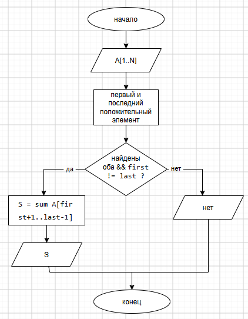

# Лабораторная работа №11 Вариант 4
  
Студент: Полякова В.Д.
Группа: бТИИ-261

## Задание

Задание 1. Массив из 10 вещественных чисел: ввод с клавиатуры, возведение каждого элемента в квадрат, вывод в виде таблицы
Задание 2. Массив из 100 чисел по функции на интервале: среднее положительных, вывод строкой, вычисление в отдельной функции.
Задание 3. Массив из n целых чисел: сумма элементов между первым и последним положительными.

**Требуется:**
1. Составить блок-схему алгоритма решения.
2. Написать программу на языке C.

## Блок-схема

